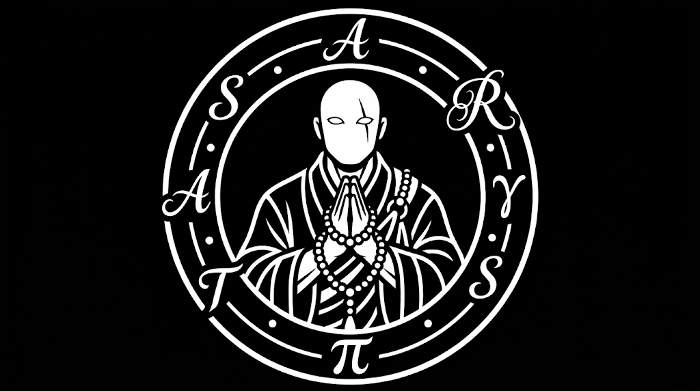

  

<h1 align="center">ReinforcePeace</h1>

COMS4061A/COMS7071A RL Assignment 2026 (ARC-AGI-3)

## Contents

| Path | What it is |
|---|---|
| `ReinforcePeace_report.pdf` | the report (RLC 2026 template, cover page disabled) |
| `code/kaggle_submission_notebook_v2.ipynb` | the Kaggle notebook of the nominated submission 57654331 |
| `code/my_agent.py` | the agent source the notebook was built from |
| `code/training_and_experiments_notebook.ipynb` | adapter, baselines, improvements, evaluation, runner (outputs cleared) |
| `code/make_report_figures.py` | builds the report's figures and numbers from code/results |
| `code/results/` | evaluation_results.csv and per-run training logs (*.monitor.csv) |
| `evidence/` | Kaggle submission IDs/scores/timestamps, nominated entry, Paper Track link and saved copy, member contributions, screenshots |
| `report/` | LaTeX source of the report |
| `docs/` | project, experiment and research logs |
| `notebooks/` | team workspace notebook |

No API keys or credentials are included. Trained model files (~8 MB each) are not included; the submitted
model is in the Kaggle dataset banelemkhize/arc-rl-agent-files.
